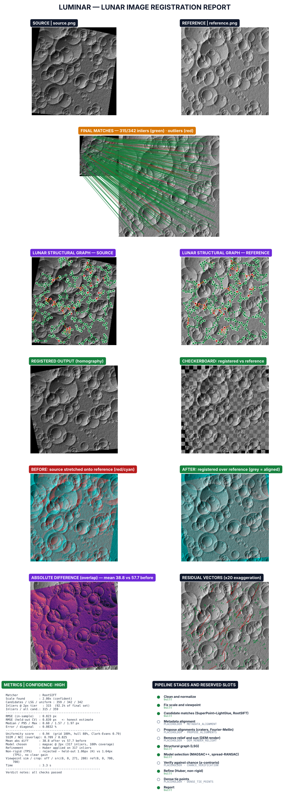

# LUMINAR

Register a Chandrayaan-2 lunar image onto an LRO / QuickMap reference image, tolerant to changes in sun angle, viewpoint and scale — and report honestly how good the result is.



*Dashboard produced by this repo's own pipeline (`tools/make_example.py`) on the built-in **synthetic** crater pair (sun direction changed by 20°, known true transform). It was generated on a CPU without PyTorch, so the matcher shown is RootSIFT; with a GPU runtime SuperPoint + LightGlue are added to the candidate pool. Measured error against the known transform: 0.17 px mean. No mission data is included in this repository.*

## Run it
1. Open `notebooks/LUMINAR.ipynb` in Google Colab (File → Open notebook → GitHub tab → paste this repo's URL).
2. Runtime → Change runtime type → **T4 GPU** (much faster; the deep matcher is slow on CPU).
3. Run the cells top to bottom. Load a source and a reference image (upload, zip, Drive link, or path), set the trim lines, then run the final cell.

The notebook is the single source of truth; it is committed with outputs cleared.

## What is built
- Input handling for PDS3/PDS4 `.IMG` products, zips and plain images; trim, orientation and scale matching
- Multi-scale RootSIFT sweep and simulated tilted views
- SuperPoint + LightGlue candidates (optional, needs PyTorch) pooled with RootSIFT
- Lunar Structural Graph: triangle side-ratio consistency filtering (classical, not a learned graph network)
- Uniform grid selection; MAGSAC++ / coverage-aware spread-RANSAC model selection with accuracy tiers; optional manual seed
- Huber refinement and optional thin-plate-spline correction, kept only if held-out error improves
- Metrics: held-out RMSE, inliers and ratio, spatial uniformity, SSIM / NCC; verdict HIGH / MEDIUM / LOW / FAILED / MANUAL
- Exports: `registered.png`, `checkerboard.png`, `match_points.csv`, `report.json`, `dashboard.png`, zip

## Reserved, not built
Placeholder hooks with fixed contracts (no-ops today; the dashboard shows them as placeholders):
`METADATA_ALIGNMENT`, `DEM_RENDER_RELIGHT`, `PROPOSE_ALIGNMENTS`, `CHANCE_VERIFICATION`, `DENSE_TIE_POINTS`. See `docs/HOOKS.md`.

## Validation
Synthetic pairs with a known transform (see `docs/VALIDATION.md`): +20° sun change gives sub-pixel error and a HIGH verdict; a 100° change is reported FAILED rather than claimed. `pytest -q` runs these checks against the notebook's own code.

## Limitations
- A single homography cannot be sub-pixel on terrain with relief seen at an angle (parallax); such pairs are expected to give LOW or FAILED verdicts until DEM relighting or official geometry is added.
- Validation is on synthetic pairs and informal real-image trials, not a labelled benchmark.
- Very large sun-angle differences with no shared appearance fail automatically by design; use the manual seed.

## Layout
```
notebooks/LUMINAR.ipynb   the pipeline (Colab), incl. Cell 9 synthetic self-test
tests/                    known-answer tests (load code from the notebook)
tools/                    clean_notebook.py, make_example.py, nbload.py
docs/                     ARCHITECTURE.md, HOOKS.md, VALIDATION.md
examples/                 synthetic dashboard
```

## Licenses and data
Code: MIT (`LICENSE`). SuperPoint weights and LightGlue have their own licenses; check them before redistributing. Chandrayaan-2 data comes from ISRO's PRADAN portal and LRO data from NASA PDS / LROC QuickMap, each under its own terms; none is committed here.
